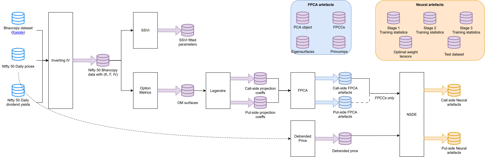

# Dissertation Code
There are many moving parts in this dissertation. This document is to help orient you, dear reader, with my code structure.

I've structured this using a pipeline-artefact type design. Each portion of the pipeline takes in data, transforms it, and saves an artefact to disk for subsequent pipes to consume and transform. Artefacts can also be analysed separately from the main pipeline. I chose this for a few reasons:
1. My R&D originally involved about 4 to 6 distinct Jupyter notebooks, with overlaps in responsibilities (processing Bhavcopies, inspecting data, fitting SSVI, preparing OM surfaces, examining the NSDE, etc.). This had to be streamlined.
2. Each Jupyter notebook included sets of plots and tabular results that I couldn't fit into my thesis. I wanted to retain this exploratory layer, but without holding unnecessary data in memory.

With this approach, there are clear start and end points for each section of the pipeline with well-defined data artefacts (see @fig:code_flow). Most conveniently, a Jupyter notebook now sits on top as an analytical layer, consuming only those artefacts necessary to recreate the plots and results in my thesis that I couldn't fit in.

{#fig:code_flow}

The assumed folder structure for this entire pipeline is as follows (assuming we start in the current folder, `./code`):

```
code/
    data/
        nse_bhavs/
        nifty-daily.csv
        nifty-div-yields.csv
        nifty-vix.csv
    funvol/
    inverting_iv/
    ssvi/
```

You, dear reader, may source the folder `nse_bhavs/` from [my Kaggle upload](https://www.kaggle.com/datasets/rasi96/nse-f-and-o-bhavcopies-2010-2019). The CSVs `nifty-daily`, `nifty-div-yields`, `nifty-vix` are provided by me exactly as used. If you prefer fresher data, then the most straightforward sources are those mentioned in §1.2 of my thesis.
